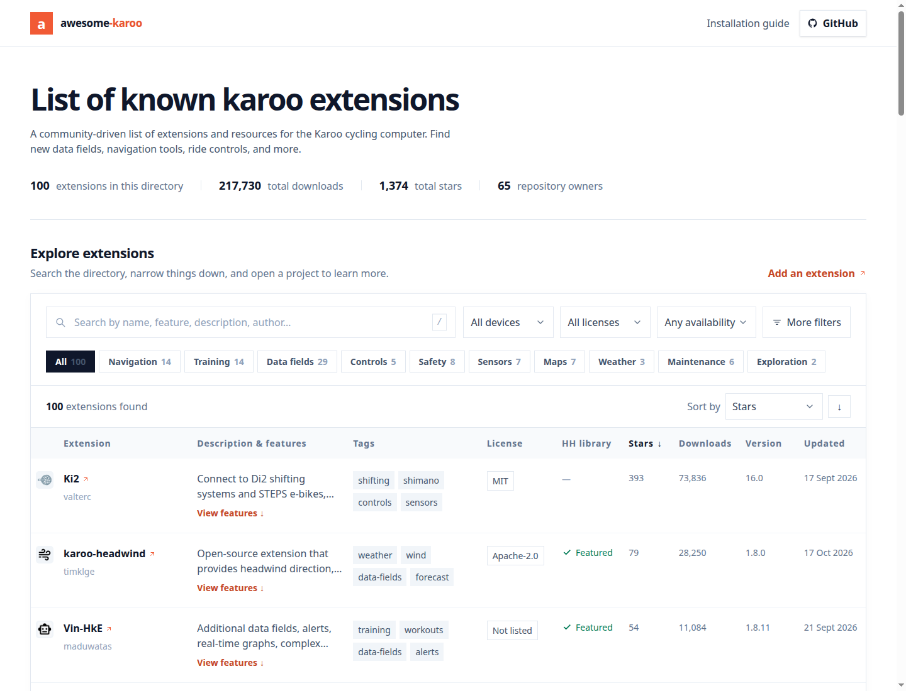

# awesome-karoo

A community-driven list of known extensions and resources for the Karoo cycling computer.

## [Browse the extension directory →](https://timklge.github.io/awesome-karoo)

Available at [https://timklge.github.io/awesome-karoo](https://timklge.github.io/awesome-karoo)

## Table of Contents

- [Introduction](#introduction)
- [Installation of extensions on your device](#installation-of-extensions-on-your-device)
  - [Sideloading](#sideloading)
- [Libraries](#libraries)
  - [ktor-client-karoo](#ktor-client-karoo)
  - [karoo-ext-testing](#karoo-ext-testing)
- [Resources](#resources)
  - [karoo-ext](#karoo-ext)
  - [karoo-custom-mapstyle](#karoo-custom-mapstyle)
  - [karoo-bulk-exporter](#karoo-bulk-exporter)
- [Contributing](#contributing)
- [Building the website](#building-the-website)
- [License](#license)

## Introduction

Recently, hammerhead has published a new SDK that enables the development of extensions for Karoo cycling computers. This repository aims to compile a comprehensive list of extensions.

## Installation of extensions on your device

A growing number of extensions featured on this list are also available in Hammerhead's official extension library. Installing these extensions is as simple as opening the "Extensions" library from the main menu on your Karoo and selecting the extension you want to install. More information is available [here](https://support.hammerhead.io/hc/en-us/articles/34676015530907-Karoo-OS-Extensions-Library).

Extensions that are not part of Hammerhead's library can be installed via Sideloading.

### Sideloading

If you are using a Karoo 3, you can use [Hammerhead's sideloading procedure](https://support.hammerhead.io/hc/en-us/articles/31576497036827-Companion-App-Sideloading) to install extensions.

1. Open the releases page of your chosen extension on your phone's browser, long-press the link to the APK (usually `app-release.apk`) and share it with the Hammerhead Companion app.
2. Your karoo should show an info screen about the app now. Press "Install".
3. Open the app from the main menu.

If you are using a Karoo 2, you can use manual sideloading:

1. Download the apk from the releases page of your chosen extension
2. Set up your Karoo for sideloading. DC Rainmaker has a great [step-by-step guide](https://www.dcrainmaker.com/2021/02/how-to-sideload-android-apps-on-your-hammerhead-karoo-1-karoo-2.html).
3. Install the app by running `adb install FILENAME.apk`.
4. Open the app from the main menu.

To update extensions after you have installed them, long-tap the app icon on the main menu and select "Update" (works on both Karoo 2 and Karoo 3).

## Resources

### karoo-ext

The new SDK to develop extensions is maintained by Hammerhead at https://github.com/hammerheadnav/karoo-ext.

### karoo-custom-mapstyle

This custom map style for the Hammerhead Karoo improves clarity, visibility, and usability for mountain biking. Check it out at [dansoft-ch/karoo-custom-mapstyle](https://github.com/dansoft-ch/karoo-custom-mapstyle)

### karoo-bulk-exporter

A PowerShell-based bulk exporter for routes from the Hammerhead dashboard. [dansoft-ch/karoo-gpx-bulk-exporter](https://github.com/dansoft-ch/karoo-gpx-bulk-exporter)

## Contributing

We welcome contributions to this repository! If you have developed an extension or resource that you believe would be beneficial to others, please follow these steps:

1. **Fork** the repository on GitHub.
2. **Create** a new branch for your contribution (`git checkout -b feature/your-extension`).
3. **Add** your extension details in the appropriate section of this README file and in `extensions.json` for the website.
4. **Commit** your changes (`git commit -m 'Add your extension'`).
5. **Push** to the branch (`git push origin feature/your-extension`).
6. **Submit** a pull request.

Please ensure that your contribution includes:
- A clear description of the extension or resource.
- License information.
- Features and benefits of the extension.

## Building the website

The Go application in [`generator/`](generator/README.md) builds the catalogue in
`static/` from `extensions.json`, resolving extension versions and GitHub statistics
at build time. See the [generator documentation](generator/README.md).

## License

This repository is licensed under the Apache 2 License. See [LICENSE](LICENSE) for more details.
